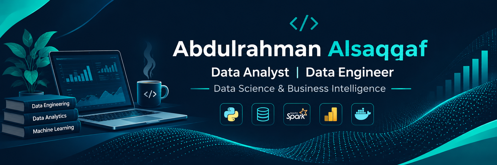

  

 

# Abdulrahman Alsaqqaf

### Data Analyst | Data Engineer | Data Science & Business Intelligence

Building data-driven solutions through Python, analytics, and scalable data systems.

---

## 👨‍💻 About Me

I'm a Data Analyst and Data Engineer passionate about transforming raw data into meaningful insights and building scalable data solutions.

My work focuses on data analytics, data engineering, business intelligence, and developing data-driven solutions using Python, SQL, Power BI, and modern data technologies.

My interests focus on:

- 📊 Data Analysis and Data Visualization
- ⚙️ Data Engineering and ETL Pipelines
- 🐍 Python Programming and Data Processing
- 🗄️ Database Management and SQL
- 🤖 Machine Learning and Predictive Analytics
- 📈 Business Intelligence and Reporting

I enjoy working with real-world datasets, solving data problems, and continuously improving my technical skills through practical projects.

## 🎯 Current Focus

- Building and improving end-to-end data pipelines.
- Developing practical Data Analytics projects.
- Exploring Apache Spark and PySpark.
- Improving SQL and database engineering skills.
- Learning more about Big Data technologies.

## 🛠️ Tech Stack

### 📊 Data Analytics & Business Intelligence

### ⚙️ Data Engineering & Big Data

### 🗄️ Databases

### 💻 Programming & Tools

## 🚀 Featured Projects

### 1. Spam Message Classification

Machine Learning and Deep Learning project for classifying SMS messages into Spam and Ham categories.

**Technologies:** Python, Pandas, Scikit-learn, BERT, NLP.

[View Repository](https://github.com/Abdulrahman-Alsaqqaf/Spam-Message-Classification-)

### 2. Money Real vs Fake Classification

A Machine Learning project focused on distinguishing between real and fake currency.

**Technologies:** Python, Machine Learning.

[View Repository](https://github.com/Abdulrahman-Alsaqqaf/money-real-vs-fake-classification)

### 3. Web Mining & Data Visualization

A practical project combining web data collection, processing, and visualization.

**Technologies:** Python, Web Scraping, Data Visualization.

[View Repository](https://github.com/Abdulrahman-Alsaqqaf/Web-Mining-Data-Visualization)

### 4. Academic Stress Project

An academic project exploring data-related techniques and analysis.

[View Repository](https://github.com/Abdulrahman-Alsaqqaf/Academic-Stress-Project)

## 📊 GitHub Statistics

  

  

## 🤝 Let's Connect

I'm always interested in learning, collaborating, and working on meaningful data projects.

- GitHub: [@Abdulrahman-Alsaqqaf](https://github.com/Abdulrahman-Alsaqqaf)

---

**"Turning Data into Insights, and Insights into Impact."**

